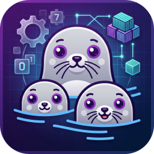

# Podman 管理器

KDE Plasma 原生的 Podman 图形管理工具，基于 PyQt6 + Podman REST API 构建。


<p align="center">
  
</p>

## 为什么选它

| 特性 | 说明 |
|---|---|
| **KDE 原生外观** | 自动继承 Breeze 样式、系统字体、图标主题、配色方案，与 Dolphin 等系统应用完全一致 |
| **暗色/亮色自动跟随** | 监听 KDE 主题变化，图标颜色实时切换，无需重启 |
| **直接调 REST API** | 不解析 CLI 输出，不依赖 `podman` 命令格式稳定性 |
| **零配置** | 自动探测 Podman socket 路径（rootless / rootful / Docker 兼容） |
| **系统托盘** | 右键快速停止/重启/访问容器，关闭窗口自动最小化 |
| **内置终端** | 无需外部终端，直接进入容器 shell |

## 功能

### 容器管理
- 列表 / 启动 / 停止 / 重启 / 暂停 / 删除
- 实时日志查看（2 秒轮询、关键词过滤、自动隐藏滚动条）
- 内置终端（pyte + pexpect 实现的 VT100 模拟）
- 端口跳转：双击端口列用浏览器打开 `http://<局域网IP>:<端口>`
- 多选批量删除（Ctrl/Shift 点击、Ctrl+A、Delete 键）
- 状态图标：实心圆（运行中）、双竖条（暂停）、循环箭头（重启中）、方块（已停止）、叉号（失效）

### 镜像管理
- 列表 / 拉取 / 删除 / 清理悬空镜像
- 支持多选批量删除
- 查看镜像详情（JSON）

### 卷与网络
- 列表 / 新建 / 删除
- 网络页内置网络（`podman`/`host`/`none`）自动置灰，不可删除

### Compose 项目管理
- 自动扫描根目录下的 compose 项目（默认 `/data`）
- 支持目录约定：`<root>/<项目>/compose/docker-compose.yml`
- 启动 / 停止 / 重启 / 拉取 / 查看日志
- YAML 编辑器（语法高亮、格式校验、保存前备份）
- 新建项目（自动生成目录结构和模板）
- 删除项目（先停止容器再删目录，三重确认）

### 资源监控
- 内存占用实时图表（每秒刷新）
- 容器内存上限设置（启动前预检查，防止超限启动）
- 各容器占用对比（两列网格，按占用率排序）

### 系统设置
- **服务管理**：用户级（rootless）与系统级（rootful）podman.socket 的开机自启、启停、重启
- **镜像加速**：8 个国内镜像预设 + 自定义地址，支持排序、启停
- **HTTP 代理**：Clash/FlClash/SOCKS5 预设，写入 `containers.conf`
- **存储配置**：切换 graphRoot、执行迁移、查看磁盘占用
- **完全重置**：一键恢复 Podman 到首次安装状态（三重确认）

### 系统托盘
- 托盘图标随主题黑白变色（海豹线稿）
- 右键菜单：容器列表（按状态图标区分）、停止/重启/访问/查看日志
- 左键单击显示主窗口
- 关闭窗口最小化到托盘，不退出程序

## 安装

### 依赖

```bash
# Arch / CachyOS
sudo pacman -S python-pyqt6 python-pyqt6-charts python-pyte python-pexpect

# 可选：打包用
sudo pacman -S python-pyinstaller  # 或用 venv + pip
```

### 前置条件：Podman socket

```bash
systemctl --user enable --now podman.socket
```

验证：

```bash
curl --unix-socket /run/user/$(id -u)/podman/podman.sock \
     --noproxy '*' http://d/v5.0.0/libpod/_ping
# 应返回 OK
```

### 方式一：源码运行

```bash
git clone <repo-url> podman-gui
cd podman-gui
./podman-gui
```

### 方式二：单文件可执行

从 [Releases](https://github.com/<user>/podman-gui/releases) 下载 `podman-gui-v*-linux-x86_64`，然后：

```bash
chmod +x podman-gui-v1.0.0-linux-x86_64
./podman-gui-v1.0.0-linux-x86_64
```

单文件约 113 MB，内含 Python 运行时、Qt 库和全部依赖。

### 方式三：安装到系统

```bash
cd podman-gui

# 启动脚本
mkdir -p ~/.local/bin
ln -sf "$PWD/podman-gui" ~/.local/bin/podman-gui

# 桌面入口
mkdir -p ~/.local/share/applications
cp resources/podman-gui.desktop ~/.local/share/applications/
update-desktop-database ~/.local/share/applications

# 图标（注意：要装到当前图标主题目录，KDE 不会去 hicolor 找应用图标）
THEME=$(kreadconfig6 --file kdeglobals --group Icons --key Theme)
for dir in hicolor "$THEME" "${THEME}-dark"; do
    for size in 16 22 24 32 48 64 128 256 512; do
        if [ "$dir" = "hicolor" ]; then
            dest="$HOME/.local/share/icons/hicolor/${size}x${size}/apps"
        else
            dest="$HOME/.local/share/icons/$dir/apps/$size"
        fi
        mkdir -p "$dest"
        cp "resources/appicon/podman-gui-${size}.png" "$dest/podman-gui.png"
    done
done

gtk-update-icon-cache -f -t ~/.local/share/icons/hicolor
kbuildsycoca6 --noincremental
```

之后在应用菜单搜索「Podman」即可。

## 项目结构

```
podman-gui/
├── main.py                     # 入口
├── podman-gui                  # 启动脚本
├── podman-gui.spec             # PyInstaller 打包配置
├── core/                       # 后端逻辑（与 UI 无关）
│   ├── config.py               # 常量、socket 候选路径
│   ├── podman_client.py        # REST API 封装（Unix socket HTTP）
│   ├── podman_config.py        # 配置文件读写、内存限额、服务管理
│   ├── compose_manager.py      # Compose 项目扫描、解析、执行
│   ├── async_task.py           # 后台任务（避免阻塞 UI）
│   ├── kde_theme.py            # KDE 主题检测与应用
│   └── notify.py               # 桌面通知（notify-send）
├── ui/                         # 界面
│   ├── main_window.py          # 主窗口（侧边栏 + 页面栈）
│   ├── sidebar.py              # 侧边导航（分组）
│   ├── style.py                # QSS 样式表（颜色取自调色板）
│   ├── widgets.py              # 通用控件（自动隐藏滚动条、空状态、输入框）
│   ├── charts.py               # 内存占用图表（QPainter 自绘）
│   ├── tray.py                 # 系统托盘
│   ├── container_page.py       # 容器页
│   ├── image_page.py           # 镜像页
│   ├── volume_page.py          # 卷页
│   ├── network_page.py         # 网络页
│   ├── pod_page.py             # Pod 页
│   ├── compose_page.py         # Compose 页（含 YAML 编辑器）
│   ├── system_page.py          # 系统概览
│   ├── settings_page.py        # 设置页（概览/服务/加速/存储/关于）
│   ├── resource_page.py        # 通用列表页基类
│   ├── log_viewer.py           # 日志查看器
│   ├── terminal.py             # 内置终端（pyte + pexpect）
│   ├── detail_dialog.py        # JSON 详情对话框
│   └── utils.py                # 时间/大小格式化、宿主机 IP
└── resources/
    ├── icons.py                # 内置 SVG 图标（含状态图标、光学尺寸统一）
    ├── appicon/                # 应用图标（多尺寸 PNG + 源 SVG）
    └── podman-gui.desktop      # 桌面入口
```

**代码规模**：约 11,000 行 Python

## 技术要点

### Podman API 版本混用

Podman 不同资源的 API 版本不一致，客户端已处理：

| 资源 | API 路径 |
|---|---|
| 容器 / 镜像 / 卷 / Pod | `/v5.0.0/libpod/` |
| 网络 | `/v4.0.0/libpod/` |

### Unix Socket HTTP

```python
class UnixHTTPConnection(http.client.HTTPConnection):
    def __init__(self, path, timeout=10):
        super().__init__('localhost', timeout=timeout)
        self._path = path

    def connect(self):
        s = socket.socket(socket.AF_UNIX, socket.SOCK_STREAM)
        s.settimeout(self.timeout)
        s.connect(self._path)
        self.sock = s
```

### 主题跟随

三级检测策略，确保在各种 KDE 配置下都能正确判断：

1. **QPalette 亮度**（首选）：`app.palette().color(Window)` 的 BT.601 感知亮度 < 128 → 暗色
2. `kreadconfig6` 读 `kdeglobals` 的 `ColorScheme`
3. 调色板 `WindowText` vs `Window` 对比

`ThemeWatcher` 每 2 秒轮询，变化时重设 QSS 并刷新所有图标。

### 图标动态渲染

图标用 `QIconEngine` 实现，每次绘制时按当前主题色实时渲染：

```python
class _ThemedIconEngine(QIconEngine):
    def _pixmap(self, size):
        color = DANGER_FG if self._danger else _fg_color()
        # 按 (颜色, 尺寸) 缓存，主题变化时自动失效
        return _render_svg(self._svg, color, size)
```

同一个 `QIcon` 对象在主题切换后自动变色，无需重建。

### 光学尺寸统一

各 SVG 的内容在 viewBox 中占比不同（`stop` 44%，`network` 94%），直接渲染会导致视觉大小差异巨大。渲染前测量内容边界，统一缩放到固定占比（78%）：

```python
bbox = _measure(svg_content)     # 测量 alpha 内容边界
scale = OPTICAL_FILL / (max(bw, bh) / PROBE)
painter.scale(scale, scale)      # 统一缩放
```

修复后图标视觉大小差异从 50% 降到 3%。

### 内置终端

```
QPlainTextEdit  ←渲染—  pyte.Screen  ←喂字节—  pexpect 子进程
      ↓ 键盘事件
  ANSI 转义序列  →  pexpect.send()
```

支持 Ctrl+C/D/L/Z、方向键、Home/End、Tab、Esc 等。

### 自动隐藏滚动条

Qt 原生 `QScrollBar` 无法「不滚动时淡出」。自绘方案：

- 关闭原生滚动条（`ScrollBarAlwaysOff`）
- 在 `viewport()` 内自绘圆角指示器
- 滚动/悬停时 220ms 淡入，静止 1.2 秒后淡出
- 支持点击/拖动跳转

### 日志流解析

Podman 日志返回 Docker 复用流格式（每帧 8 字节头）：

```
字节 0    : 流类型 (0=stdin, 1=stdout, 2=stderr)
字节 1-3  : 填充
字节 4-7  : 负载长度（大端 uint32）
字节 8-   : 实际内容
```

`_demux_log_stream()` 逐帧剥离头部；非复用流（纯文本）原样返回。

### 通知

使用 `notify-send`（libnotify）而非 D-Bus 直连——PyQt6 的 `QtDBus` 在序列化 `a{sv}` 嵌套类型时会崩溃。

### 内存限额

Podman 没有全局容器内存上限，采用**启动前预检查**：

```
已运行容器 mem_limit 之和 + 目标容器 limit > 阈值 → 拒绝启动
```

阈值存于 `QSettings`，不写入 Podman 配置。实测读取各容器 cgroup 的 `memory.current` 显示实际占用。

### 后台任务

`version()` 和 `system_info()` 各需约 900ms，同步调用会冻结 UI 1.8 秒。所有耗时操作走 `async_task.BackgroundTask`：

```python
run_async(fn, on_done=callback, on_error=err_callback, parent=self)
```

程序退出时 `shutdown_all()` 等待所有线程结束，避免 Qt 强制终止导致 abort。

## 打包

```bash
# 创建构建环境（必须 --system-site-packages 才能找到系统 PyQt6）
python3 -m venv --system-site-packages .build-venv
source .build-venv/bin/activate
pip install pyinstaller

# 打包
pyinstaller --clean --noconfirm podman-gui.spec

# 产物
ls -lh dist/podman-gui
```

**注意**：`excludes` 里不能排除 `email`、`html`、`unittest` 等标准库，因为 `http.client` 依赖它们。

## 已知限制

- **仅支持 Linux**（Unix socket）。macOS / Windows 需要额外的 socket 适配，代码已预留 `SOCKET_CANDIDATES` 分支但未实现
- 不支持容器创建向导（可用 `podman run` 或 Compose）
- 资源图表仅显示内存（CPU / 网络图表未实现）
- 卷页不显示 bind mount（Podman API 不提供该信息，只能从容器 inspect 读取）

## 许可证

MIT
